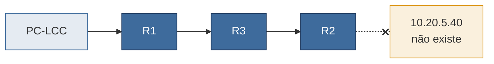
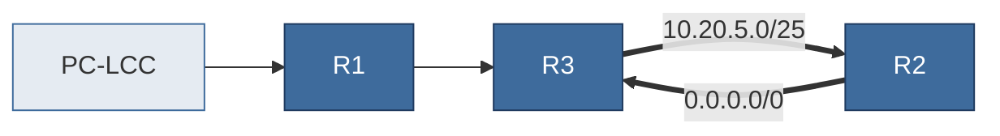

- [3. Falha 1: a rota de volta](#3-falha-1-a-rota-de-volta) : Tirar uma rota e ver o ping falhar com a ida correta
- [4. Falha 2: o resumo inexato](#4-falha-2-o-resumo-inexato) : Trocar rotas específicas por um `/25` no CAA | Pergunta 1 |
- [5. Desafio: o loop com rota padrão](#5-desafio-o-loop-com-rota-padrão) : Fazer um pacote andar em círculos

## 3. Falha 1: a rota de volta

**Objetivo:** ver que comunicação exige rota nos dois sentidos.


### 3.1 Tirar a rota

No **R3**, remova a rota para o REENGE. Se a sua tabela usa outras rotas para isso, remova as suas.

```
configure terminal
no ip route 10.20.4.0/25 10.20.0.1
end
```

### 3.2 Testar

Antes de executar, pense: o pacote do PC-LCC ainda chega ao PC-CH?

Em **PC-LCC**:

```
ping 10.20.5.2
trace 10.20.5.2
```

Em **PC-CH**:

```
trace 10.20.4.2
```

**Resultado esperado:** o ping falha. No `trace` do PC-LCC, só o R1 responde. No `trace` do PC-CH, o último a responder é o `10.20.0.6` (R3), avisando que não há rota.

<!-- PROFESSOR: colar aqui a saída real de "trace 10.20.4.2" no PC-CH -->

### Para pensar

1. O pedido do ping chegou ao PC-CH?
2. Por que os dois `trace` mostram coisas tão diferentes, se a rota que falta é a mesma?

<details><summary>Resposta</summary>

1. Chegou. O R3 ainda sabe chegar ao CAA. O que se perde é a **resposta**, porque o R3 não sabe voltar ao REENGE.
2. No sentido do PC-CH, o R3 consegue avisar o PC-CH, cuja rede ele conhece. No sentido do PC-LCC, o R3 tenta responder ao PC-LCC, mas é justamente essa a rede para a qual ele não tem rota, então a resposta nunca sai.

</details>

### 3.3 Desfazer

No **R3**, coloque a rota de volta e confirme com um `ping 10.20.5.2` em PC-LCC.

```
configure terminal
ip route 10.20.4.0/25 10.20.0.1
end
```

### Não funcionou? Confira

- O ping continua funcionando depois de tirar a rota → veja em `show ip route`, no R3, se ainda há outra rota para o REENGE. Sua tabela pode usar rotas diferentes.
- O ping não voltou depois de desfazer → confira no R3 se o next-hop digitado é o `10.20.0.1`.

---

## 4. Falha 2: o resumo inexato

**Objetivo:** ver o que acontece com os endereços que uma rota resumida cobre sem que existam.

Na Pergunta 1 da folha, o menor bloco que cobre os dois laboratórios do CAA é o `10.20.5.0/25`, com 80 endereços a mais. Agora você vai ver o que esses endereços causam.



### 4.1 Antes da mudança

Em **PC-LCC**:

```
trace 10.20.5.40
```

**O que procurar:** só o `10.20.4.1` (R1) responde. O R1 não tem rota para esse endereço e descarta o pacote já no primeiro salto.

### 4.2 Trocar pelo resumo

No **R1**:

```
configure terminal
no ip route 10.20.5.0/27 10.20.0.2
no ip route 10.20.5.64/28 10.20.0.2
ip route 10.20.5.0/25 10.20.0.2
end
```

No **R3**:

```
configure terminal
no ip route 10.20.5.0/27 10.20.0.5
no ip route 10.20.5.64/28 10.20.0.5
ip route 10.20.5.0/25 10.20.0.5
end
```

Se as suas rotas forem outras, remova as suas no lugar dessas.

### 4.3 Testar

Em **PC-LCC**:

```
ping 10.20.5.2
ping 10.20.5.66
trace 10.20.5.40
```

**Resultado esperado:** os dois pings continuam funcionando. O `trace` agora atravessa a rede e o último a responder é o `10.20.0.5` (R2), avisando que não há rota.

<!-- PROFESSOR: colar aqui a saída real de "trace 10.20.5.40" no PC-LCC -->

### Para pensar

1. Para os laboratórios, nada mudou. Então qual é o custo do resumo inexato?
2. Em uma rede maior, o que aconteceria se houvesse milhares de pacotes para endereços como esse?

<details><summary>Resposta</summary>

1. Pacotes para endereços que não existem deixam de ser descartados no primeiro roteador e atravessam dois enlaces até morrer no R2.
2. Esse tráfego inútil consumiria banda e processamento nos enlaces do núcleo. Em troca, a tabela fica menor: é uma decisão de projeto, não um erro em si.

</details>

### Não funcionou? Confira

- O `trace` ainda para no R1 → a rota `10.20.5.0/25` não entrou no R1. Confira com `show ip route`.
- Os pings para os laboratórios falharam → uma rota foi removida e o `/25` não entrou. Confira o R1 e o R3.

Mantenha o resumo: a próxima parte depende dele.

---

## 5. Desafio: o loop com rota padrão

**Objetivo:** ver como um resumo inexato e uma rota padrão, juntos, podem fazer um pacote andar em círculos.

Com o resumo no lugar, o R3 envia ao R2 tudo que está no `10.20.5.0/25`. Se o R2 tiver uma rota padrão apontando para o R3, ele devolve ao R3 o que não conhece.



### 5.1 Criar a rota padrão

No **R2**:

```
configure terminal
ip route 0.0.0.0/0 10.20.0.6
end
```

Em **PC-LCC**:

```
trace 10.20.5.40
```

**O que procurar:** R1, R3 e R2 respondem, e depois só aparecem `*`. O pacote voltou ao R3 e sumiu.

### 5.2 Por que o loop não apareceu

O R3 recebeu pela `eth1` um pacote com origem no REENGE, mas a rota para o REENGE sai pela `eth0`. O *reverse path filter* do Linux trata isso como suspeito e descarta o pacote. É uma proteção real, que às vezes salva a rede. Para ver o problema de fundo, desligue-a **no R3**. Saia do `vtysh` e, no shell do Linux:

```
exit
sysctl -w net.ipv4.conf.all.rp_filter=0 net.ipv4.conf.eth1.rp_filter=0
vtysh
```

Ao voltar para o `vtysh`, o prompt aparece como `frr#`, mas você continua no R3.

Em **PC-LCC**:

```
trace 10.20.5.40
```

**Resultado esperado:** depois do R1, os saltos se alternam entre `10.20.0.2` (R3) e `10.20.0.5` (R2) até o limite do `trace`.

<!-- PROFESSOR: colar aqui a saída real de "trace 10.20.5.40" com o loop -->

### Para pensar

1. O que impede que esse pacote circule para sempre?
2. Qual das duas configurações você mudaria para acabar com o loop?

<details><summary>Resposta</summary>

1. O campo **TTL**. Cada roteador o diminui em 1 e, quando chega a zero, descarta o pacote.
2. Qualquer uma resolve: usar rotas exatas no R3 ou tirar a rota padrão do R2. A solução comum em redes reais é ter no R2 rotas de descarte para o bloco do prédio, que são mais específicas que a rota padrão.

</details>

### 5.3 Desfazer

No **R3**, religue o filtro:

```
exit
sysctl -w net.ipv4.conf.all.rp_filter=1 net.ipv4.conf.eth1.rp_filter=1
vtysh
```

No **R2**:

```
configure terminal
no ip route 0.0.0.0/0 10.20.0.6
end
```

No **R1**:

```
configure terminal
no ip route 10.20.5.0/25 10.20.0.2
ip route 10.20.5.0/27 10.20.0.2
ip route 10.20.5.64/28 10.20.0.2
end
```

No **R3**:

```
configure terminal
no ip route 10.20.5.0/25 10.20.0.5
ip route 10.20.5.0/27 10.20.0.5
ip route 10.20.5.64/28 10.20.0.5
end
```

Confirme: em PC-LCC, `ping 10.20.5.2` funciona e `trace 10.20.5.40` volta a parar no R1. Se quiser guardar esse estado, rode `write memory` nos três roteadores.

### Não funcionou? Confira

- O `trace` não mostra o R2 → confira se o R1 tem a rota para o enlace R2–R3, da parte 2.
- O loop não aparece mesmo com o filtro desligado → confira no R2 a rota `0.0.0.0/0` e, no R3, a rota `10.20.5.0/25`.
- Depois de `exit`, os comandos do FRR dão erro → você está no shell do Linux (`frr:~#`). Digite `vtysh`.

---
