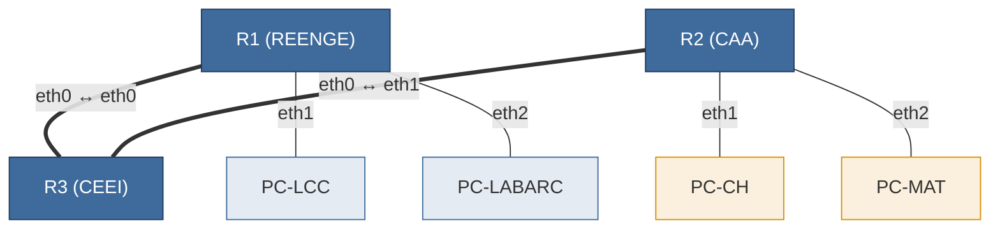
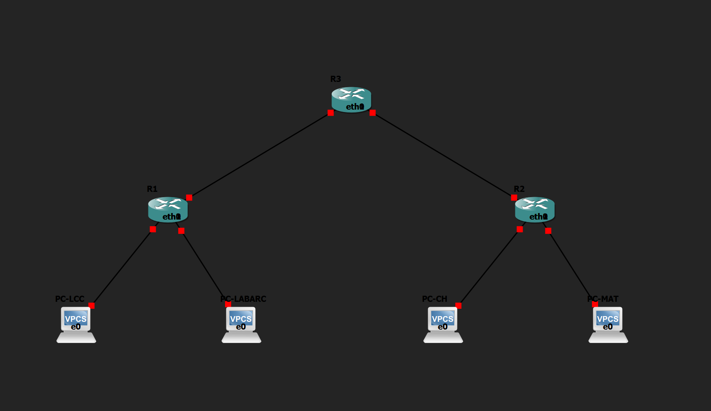
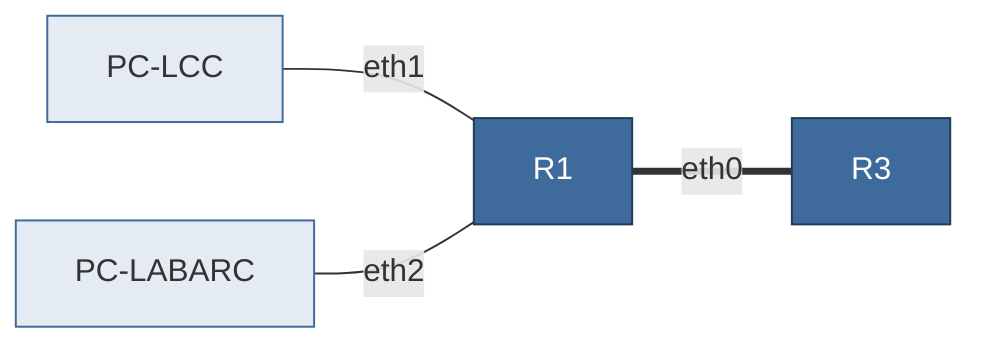
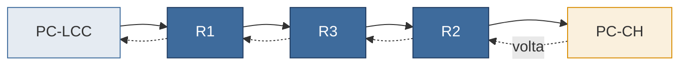

# Laboratório rotas estáticas e sumarização

Este guia leva para o GNS3 o cenário da folha *Rotas estáticas e sumarização*. Você vai configurar nos roteadores as tabelas que preencheu no papel, testar se elas funcionam e depois provocar três falhas para ver o que cada erro causa de verdade.

- [Preparação](#preparação) :  Importar o cenário e abrir os consoles
- [1. Interfaces e rotas conectadas](#1-interfaces-e-rotas-conectadas) Dar IP aos roteadores e ver as rotas conectadas surgirem
- [2. Rotas estáticas](#2-rotas-estáticas) : Digitar as suas rotas e testar de ponta a ponta
- [3. Avise o professor](#checkpoint)
- [Quero um desafuio  maior](#quero-mais-desafios) : Achei facil, quero um desafio maior.

> **Dica:** antes de cada parte, tire um *snapshot* no GNS3 (*Edit → Manage snapshots*). Se algo der errado, você volta ao início da parte em vez de recomeçar tudo.

## Preparação

Dois prédios, cada um com um roteador e dois laboratórios, ligados ao roteador do CEEI. Cada laboratório é representado por um único PC.



Cenário identico a folha de exercicio.

### Plano de endereçamento

Os roteatores terão esses IPs

| Roteador | Interface | Ligada a       | Endereço         |
| -------- | --------- | -------------- | ----------------- |
| R1       | `eth0`  | R3             | `10.20.0.1/30`  |
| R1       | `eth1`  | LCC            | `10.20.4.1/26`  |
| R1       | `eth2`  | LABARC         | `10.20.4.65/26` |
| R2       | `eth0`  | R3             | `10.20.0.5/30`  |
| R2       | `eth1`  | Lab. CH        | `10.20.5.1/27`  |
| R2       | `eth2`  | Lab. Materiais | `10.20.5.65/28` |
| R3       | `eth0`  | R1             | `10.20.0.2/30`  |
| R3       | `eth1`  | R2             | `10.20.0.6/30`  |

Endereçamento sugerido para os PCs

| PC        | Endereço         | Gateway        |
| --------- | ----------------- | -------------- |
| PC-LCC    | `10.20.4.2/26`  | `10.20.4.1`  |
| PC-LABARC | `10.20.4.66/26` | `10.20.4.65` |
| PC-CH     | `10.20.5.2/27`  | `10.20.5.1`  |
| PC-MAT    | `10.20.5.66/28` | `10.20.5.65` |

### Importando o cenário

1. No GNS3, importe o arquivo [`rotas-estaticas.gns3project`](https://drive.google.com/file/d/1cq-iaNz43t8Eg1jBEc2FYvXBv2rpLJup/view?usp=sharing): *File → Import portable project*.
3. O projeto já vem montado: três roteadores sem configuração, quatro PCs com os IPs da tabela e todos os cabos ligados. A imagem do roteador está dentro do arquivo, então você não precisa instalar mais nada.



### Acessando os equipamentos

1. Inicie todos os nós (▶ verde).
2. Clique duas vezes em um nó para abrir o console. Cada console abre em uma janela com o nome do equipamento.
3. Nos **roteadores**, espere aparecer o prompt `frr#`. Não há login. Se ele não aparecer depois do boot, tecle Enter.
4. No **VPCS**, o prompt é o nome do PC (`PC-LCC>`).

Os roteadores usam o **FRRouting (FRR)**, um software de roteamento que roda em Linux. O console abre no `terminal`, a interface de comandos do FRR, e é nele que você vai trabalhar. Se aparecer `frr:~#`, você saiu para o shell do Linux: digite `vtysh` para voltar.

### Ponto de partida

Em qualquer roteador cheque as rotas.

```
show ip route
```

Repare qye a tabela vem vazia.

Agora em qualquer PC verifique as configurações dos pcs.

```
show ip
```

**O que procurar:** o IP e o gateway da tabela acima.

---

## 1. Interfaces e rotas conectadas

**Objetivo:** ver as rotas conectadas aparecerem assim que as interfaces recebem endereço.

Nenhum roteador conhece rede alguma até que uma interface receba um IP. A partir daí, a rede daquela interface entra na tabela automaticamente, sem você escrever rota nenhuma.



### 1.1 Configurar o R1

No **R1**:

```
configure terminal
hostname R1
interface eth0
ip address 10.20.0.1/30
exit
interface eth1
ip address 10.20.4.1/26
exit
interface eth2
ip address 10.20.4.65/26
exit
end
```

`hostname` só muda o nome no prompt, para você não digitar no roteador errado. `end` volta do modo de configuração para o modo normal.

### 1.2 Configurar o R2 e o R3

Faça o mesmo no **R2** e no **R3**, usando `hostname R2` e `hostname R3` e os endereços do plano. Lembre que o R3 só tem duas interfaces em uso.

### 1.3 Ver as rotas conectadas

No **R1**:

```
show interface brief
show ip route
```

**O que procurar:** `eth0`, `eth1` e `eth2` como `up`, cada uma com o seu endereço. As interfaces não configuradas ficam `down`, e isso é normal. A tabela de rotas do R1 fica assim (o tempo no fim da linha muda):

```
C>* 10.20.0.0/30 is directly connected, eth0, weight 1, 00:00:13
L>* 10.20.0.1/32 is directly connected, eth0, weight 1, 00:00:13
C>* 10.20.4.0/26 is directly connected, eth1, weight 1, 00:00:11
L>* 10.20.4.1/32 is directly connected, eth1, weight 1, 00:00:11
C>* 10.20.4.64/26 is directly connected, eth2, weight 1, 00:00:08
L>* 10.20.4.65/32 is directly connected, eth2, weight 1, 00:00:08
```

As linhas `C` são as rotas **conectadas** da sua folha. As linhas `L` são o endereço do próprio roteador em cada interface: o FRR as mostra, mas elas não entram na sua tabela.

### 1.4 Testar

No **R1**, teste o vizinho. O ping do roteador não para sozinho: encerre com `Ctrl+C`.

```
ping 10.20.0.2
```

No **PC-LCC**:

```
ping 10.20.4.1
ping 10.20.4.66
ping 10.20.0.1
ping 10.20.0.2
ping 10.20.5.2
```

**Resultado esperado:**

- Funcionam: o gateway `10.20.4.1`, o PC-LABARC `10.20.4.66` e a interface `10.20.0.1` do R1.
- **Não funcionam:** `10.20.0.2` (R3) e `10.20.5.2` (PC-CH).

<!-- PROFESSOR: colar aqui a saída real de "ping 10.20.5.2" no PC-LCC -->

### Para pensar

1. Por que o PC-LCC alcança o PC-LABARC sem nenhuma rota estática?
2. O R1 consegue pingar o `10.20.0.2`, mas o PC-LCC não. O que falta, e em qual roteador?

[REMOVER ISSO NA VERSAO DOS ALUNOS]

<details><summary>Resposta</summary>

1. As duas redes estão conectadas ao R1, então ele já sabe entregar nas duas.
2. O pacote do PC-LCC chega ao R3, mas o R3 não sabe voltar para a rede `10.20.4.0/26`. Falta uma rota **no R3**. O ping do R1 funciona porque a origem dele é o `10.20.0.1`, de uma rede que o R3 conhece.

</details>

<!-- ### Não funcionou? Confira

Se o seu exemplo não funcionou tente essas estrategias.

- Interface `down` depois de configurada → confira o nome (`eth0`, `eth1`...) e se o IP foi aceito, com `show running-config`.
- O PC não alcança o gateway → confira com `show interface brief` se o IP do roteador é o gateway daquela rede, e veja no GNS3 em qual interface o cabo está.
- `% Unknown command` → você provavelmente não está no modo certo. `ip address` só funciona dentro de `interface`, depois de `configure terminal`. -->

## 2. Rotas estáticas

**Objetivo:** configurar as tabelas de roteamento e comprovar que elas funcionam de ponta a ponta.



### 2.1 Digitar as suas rotas

O comando tem a forma `ip route <rede de destino> <next-hop>`. Por exemplo, com endereços que não fazem parte desta atividade:

```
configure terminal
ip route 172.16.9.0/24 172.16.0.2
end
```

Observe a sua folha de resposta e procure verifique a similaridade

Agora digite **as rotas estáticas** em cada roteador: R1, R2 e R3.

Se a sua tabela do R1 não tem rota para o enlace R2–R3, acrescente essa rota agora. O mesmo vale para o R2 e o enlace R1–R3. Sua folha trata essas rotas como opcionais, mas aqui elas são necessárias para o `trace` mostrar todos os saltos: a parte "Para pensar" explica o motivo.

Se você errar uma rota, apague-a repetindo o comando com `no` na frente, dentro de `configure terminal`:

```
no ip route 172.16.9.0/24 172.16.0.2
```

### 2.2 Comparar com a folha

Em **cada roteador**:

```
show ip route
```

**O que procurar:** uma linha `C` para cada rota conectada e uma linha `S` para cada rota estática da sua tabela. As linhas `S` indicam entre colchetes a preferência da rota e, depois de `via`, o next-hop que você digitou.

### 2.3 Testar

Em **PC-LCC**:

```
ping 10.20.5.2
ping 10.20.5.66
trace 10.20.5.2
```

Em **PC-MAT**:

```
ping 10.20.4.2
ping 10.20.4.66
```

**Resultado esperado:**

- Todos os pings funcionam.
- O `trace` passa por `10.20.4.1` (R1), `10.20.0.2` (R3), `10.20.0.5` (R2) e chega ao `10.20.5.2`.
- **Não deve funcionar:** `ping 10.20.5.40`, em PC-LCC. Esse endereço não pertence a nenhum laboratório.

### 2.4 Salvar

Em **cada roteador**:

```
write memory
```

Sem isso, a configuração se perde quando o roteador é desligado. Ao religar, as interfaces e as rotas voltam, mas o prompt retorna a `frr#`: use o nome da janela para saber onde está.

### Para pensar

1. Sem a rota para o enlace distante, o `trace` mostra `*` no salto do R2, embora os pings funcionem. Por quê?
2. Compare o `trace` do PC-LCC com a sua tabela do R3. Qual linha da tabela decidiu cada salto?

[REMOVER ISSO]

<details><summary>Resposta</summary>

1. O R2 responde ao `trace` usando o endereço `10.20.0.5`. Ao receber esse pacote, o R1 não conhece a rede de origem e o descarta: o Linux tem um filtro que rejeita pacotes vindos de origens que ele não saberia alcançar pela mesma interface, o *reverse path filter*. Os pings entre PCs funcionam porque as origens deles são redes conhecidas.
2. O R3 consulta o destino `10.20.5.2`, que casa com a rota do Lab. CH, e entrega ao next-hop `10.20.0.5`.

</details>

<!-- ### Não funcionou? Confira

- `ping` falha em um único sentido → compare os next-hops dos dois lados: uma rota de volta deve estar faltando.
- Rota digitada não aparece em `show ip route` → o next-hop precisa estar em uma rede conectada ao roteador. Confira o endereço.
- Para localizar o problema, use o `trace`: o último salto que responde é o último roteador que soube encaminhar. Confira a tabela do roteador seguinte. -->

## Checkpoint

> Chame o professor para demosntrar o funcionamento

## Quero mais desafios

Essa laboratorio pode continuar, acesse a parte [desafio.md](DESAFIO.md)

## Resumo dos comandos

Roteador (FRR)

| Para…                           | Comando                                                           |
| -------------------------------- | ----------------------------------------------------------------- |
| Entrar no modo de configuração | `configure terminal`                                            |
| Sair do modo de configuração   | `end`                                                           |
| Dar nome ao roteador             | `hostname R1`                                                   |
| Configurar uma interface         | `interface eth0`, depois `ip address 10.20.0.1/30` e `exit` |
| Criar uma rota estática         | `ip route <rede> <next-hop>`                                    |
| Remover uma rota estática       | `no ip route <rede> <next-hop>`                                 |
| Ver as interfaces                | `show interface brief`                                          |
| Ver a tabela de rotas            | `show ip route`                                                 |
| Ver a configuração atual       | `show running-config`                                           |
| Testar conectividade             | `ping <ip>` (encerre com `Ctrl+C`)                            |
| Salvar a configuração          | `write memory`                                                  |
| Ir para o shell do Linux         | `exit`                                                          |
| Voltar do shell para o FRR       | `vtysh`                                                         |

PC (VPCS)

| Para…               | Comando        |
| -------------------- | -------------- |
| Ver IP e gateway     | `show ip`    |
| Testar conectividade | `ping <ip>`  |
| Ver o caminho        | `trace <ip>` |
